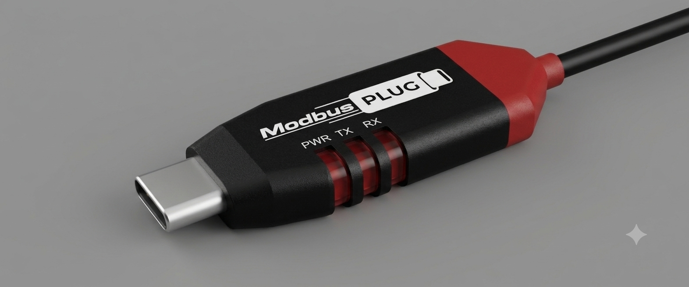

# ModbusPlug

USB Type-C to RS-485 Modbus RTU dongle for phones, rugged tablets, and laptops.

ModbusC is an open-source USB-C to RS-485 adapter designed for field engineers who work from rugged phones and tablets instead of laptops. The project was created to showcase PCB design skills while providing a compact, Type-C-native alternative to the usual USB-A Modbus dongles.

  

---

# Features
- USB Type-C receptacle (USB 2.0 full-speed)
- USB-to-UART bridge using CP2102N
- RS-485 interface using SN65HVD75
- IEC 61000-4-2 ±12 kV contact ESD protection on bus pins
- Power status LED and UART TX/RX activity LEDs
- Fixed 120 Ω termination
- Compact PCB layout

---

# Design Goals

The objective of this project was to:

- Create a Type-C-native Modbus RTU adapter
- Remove the need for USB-A adapters and laptops in field work
- Demonstrate PCB design and hardware integration skills
- Provide an open-source reference design for engineers and hobbyists
