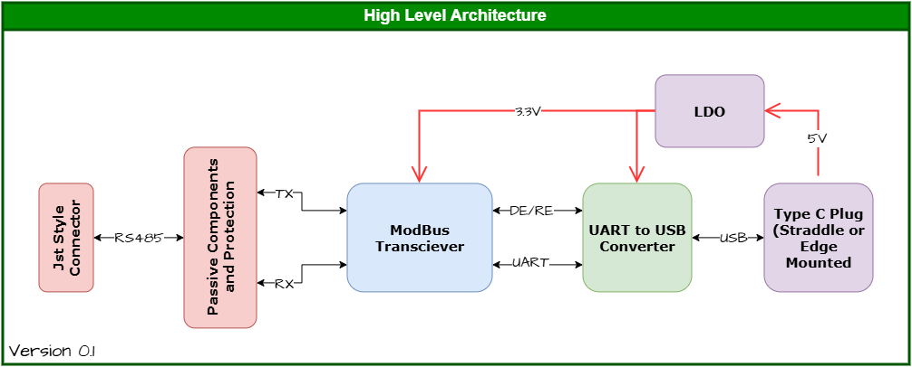
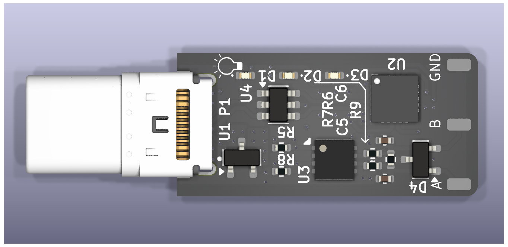
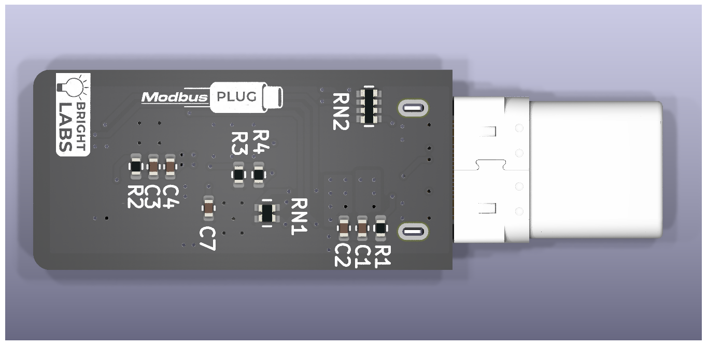
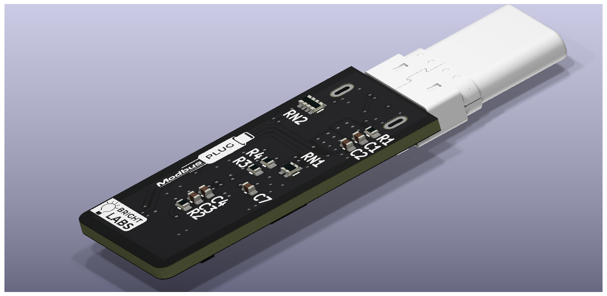
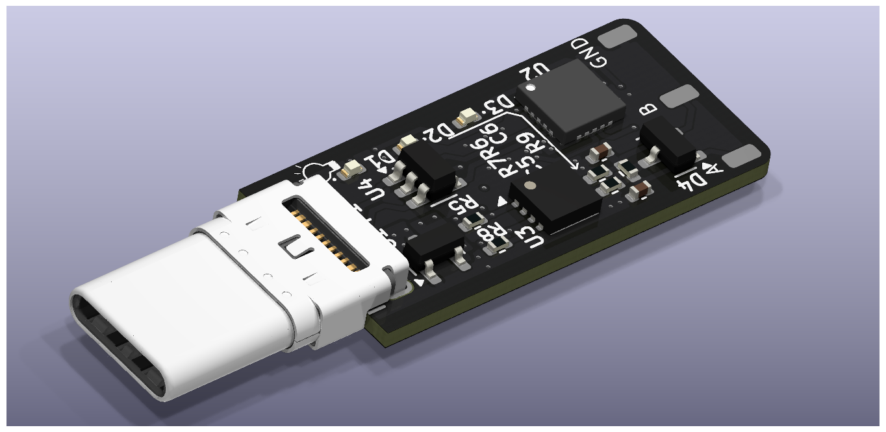
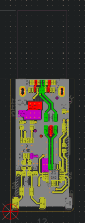
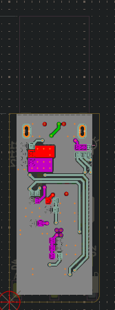
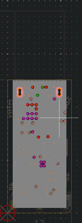
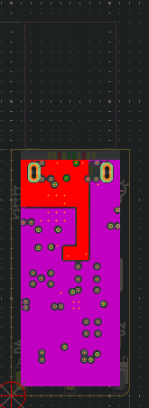

# ModbusPlug

USB Type-C to RS-485 Modbus RTU dongle for phones, rugged tablets, and laptops.

ModbusPlug is an open-source USB-C to RS-485 adapter designed for field engineers who work from rugged phones and tablets instead of laptops. The project was created to showcase PCB design skills while providing a compact, Type-C-native alternative to the usual USB-A Modbus dongles.

  

<em>AI-generated concept render of a possible enclosure. The real shell is not designed yet (see Help Wanted).</em>

---

## Features

- USB Type-C receptacle (USB 2.0 full-speed)
- USB-to-UART bridge using CP2102N
- RS-485 interface using SN65HVD75
- IEC 61000-4-2 ±12 kV contact ESD protection on bus pins
- Power status LED and UART TX/RX activity LEDs
- Fixed 120 Ω termination
- Compact PCB layout

---

## Design Goals

The objective of this project was to:

- Create a Type-C-native Modbus RTU adapter
- Remove the need for USB-A adapters and laptops in field work
- Demonstrate PCB design and hardware integration skills
- Provide an open-source reference design for engineers and hobbyists

---

## Block Diagram

  

---

## Images

### PCB

|||
|--|--|
|||

### Layout

|||
|--|--|
|||

---

## Manufacturing Status

> ⚠️ Design Complete — Not Yet Manufactured

This repository currently contains the completed design files and manufacturing outputs. Physical prototypes have not yet been fabricated or tested.

---

## Help Wanted: The Enclosure

The PCB is done, but the shell is not. I'm an electronics engineer, and enclosure CAD is not where I want to spend my weekends.

If you'd like to design a case for this board:

- Rugged and 3D-printable (FDM or resin)
- Openings for the USB-C port, RS-485 terminals, and LEDs
- Open a pull request with STEP/STL files in an `Illustration/` folder and you'll be credited here

---

## License

This project is released under the MIT License.

See the `LICENSE` file for details.

---

## Author

Designed by **Nikhil Motagi**.

If you find this project useful, feel free to star the repository and share your feedback.